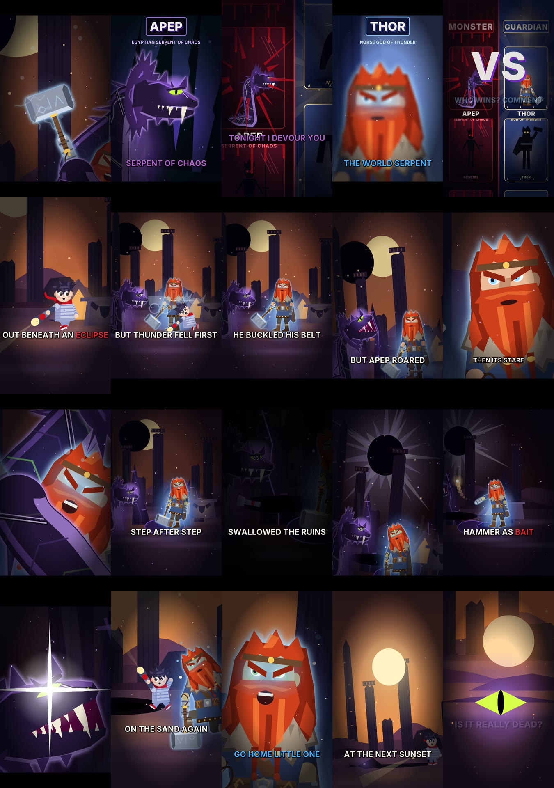

# Horror Short: Battle Spin (Monster vs Guardian)

Bộ quy chuẩn, đội agent và engine hoạt hình để làm video kinh dị dọc (TikTok / Reels / YouTube Shorts) tiếng Anh theo format **Battle Spin**:
- Hook *in medias res* + **"WHO SURVIVES?"**, tua ngược glitch.
- **Split-Roll MONSTER | GUARDIAN**, mỗi bên có màn tự giới thiệu ~5 s trong lãnh địa riêng, sau đó **VS · "WHO WINS? COMMENT"**.
- Monster khổng lồ theo lore áp đảo khung hình, thân thành địa hình chiến trường.
- Trận 1v1 kiểu **Sakuga Cinematic** (beam, beam-clash, orbs, slash, pillar, letterbox, tàn lửa) trên một chiến trường duy nhất. THE KID chạy đi nấp và không xuất hiện trong khung giao chiến.
- Tempo vừa, dễ hiểu: 85–100 s, 50–60 cảnh, −14 LUFS.

Toàn bộ video dựng bằng **engine hoạt ảnh khớp xương SVG** (`tools/anim/`, Playwright Chromium). Không dùng ảnh tĩnh, Ken Burns, thanh HP hay thẻ ROUND.

▶ **Tập mẫu chuẩn #003 · APEP vs THOR (94 s):** [`episodes/apep-vs-thor/preview/apep-vs-thor.mp4`](episodes/apep-vs-thor/preview/apep-vs-thor.mp4): tempo vừa, Apep khổng lồ cuộn quanh sa mạc, nhật thực, đủ 3 cổng duyệt.



Demo engine tối giản (26 s, không tiếng): [`tools/anim/demo/sakuga-demo.mp4`](tools/anim/demo/sakuga-demo.mp4).

## Tóm tắt luật (chi tiết: [docs/07](docs/07-format-battle-spin.md))

| Phần | Luật chính |
|---|---|
| Nhịp tập | Hook 0–3 s → Split-Roll + intro Monster ~5–6 s → intro Guardian ~5–6 s → VS → mở truyện → guardian chắn đòn + bé chạy đi → 1v1 3 nhịp → đòn kết → hậu trận → kết lửng. 85–100 s, 50–60 cảnh |
| Cốt truyện | Cặp có xung đột lore tự nhiên; guardian có giới hạn có nguồn bị monster khai thác; thắng bằng điểm yếu đã cài từ trước, không bằng may |
| Thoại | Intro ngôi thứ nhất 12–18 từ (tôi là ai → nguồn gốc → đe dọa/thách thức); trong trận ≤ 1 câu mỗi bên; thoại cuối guardian gài lore, bé ≤ 3 từ; thì thầm kết ≤ 5 từ |
| Kết lửng | Bình yên giả → nhạc tắt + dấu hiệu → monster/hậu quả lộ diện + thì thầm + CTA; dựa điều kiện lore |
| Tạo hình | Guardian: rim light, aura 2–3 lớp theo nguồn, mắt lóe. Monster: bất đối xứng, aura bệnh hoạn; khổng lồ theo lore thì thân thành địa hình. Không thiết kế phim/game |
| Animation | Anticipation → action → follow-through; impact frame = flash + shake + recoil; không pose đứng im |
| Sức mạnh | ≥ 3 có nguồn mỗi bên; chuỗi 2–4 cảnh theo công thức loại (tia, vũ khí ném, đạn cầu, chém, thức tỉnh, ánh mắt, siết, địa hình, đụng chưởng) |
| Camera | Một chiến trường, mọi shot push + pan, whip theo hướng đạn, slow-mo + crash ở đòn kết, trục 180° |
| Kiểm tra | `render.js --check` = `180-RULE OK`; `validate.js` = 0 FAIL |

## Luật bắt buộc

| # | Tài liệu | Nội dung |
|---|---|---|
| 07 | [Kinh thánh Battle Spin](docs/07-format-battle-spin.md) | Engine, nhịp tập theo giây, mở đầu + intro, cốt truyện, THE KID, thoại, kết lửng, tạo hình, animation, hoạt họa sức mạnh, camera, âm thanh, phụ đề, kiểm tra tự động |
| 08 | [Hệ thống biến thể](docs/08-he-thong-bien-the.md) | Bảng A–F, luật chống lặp, `episodes/_registry.md`, tạo hình nhân vật |
| 09 | [Kho nhân vật](docs/09-kho-nhan-vat.md) | Monster + Guardian nổi tiếng: thần thoại / truyền thuyết / truyền thuyết đô thị **phương Tây**, **Ai Cập cổ**, **Lưỡng Hà** + **Nhật Bản**. Không lấy châu Á khác |
| 06 | [Dàn nhạc agent](docs/06-dan-nhac-agent.md) | Boss (Opus) + scout (Haiku) + writer, producer (Sonnet); quy trình 3 cổng trong [`CLAUDE.md`](CLAUDE.md) |

Tham khảo: [01 · Phân tích video mẫu](docs/01-phan-tich-video-mau.md) · [05 · Giọng đọc trầm](docs/05-giong-doc-tram.md) · [Kỹ thuật khoe sức mạnh kiểu anime](docs/research/anime-power-techniques.md).

## Làm một tập mới

```text
/episode <monster> vs <guardian>
```

Boss chọn tổ hợp biến thể, giao `scout` tra lore + bảng sức mạnh có nguồn, `writer` viết `script-anim.md`, `producer` làm âm thanh, rig, timeline và dựng. Boss duyệt 3 cổng. Mọi tập nằm trong `episodes/<slug>/`.

## Cấu trúc

| Thư mục | Nội dung |
|---|---|
| `tools/anim/` | Engine: `rigs.js`, `stage.js`, `sakuga.js`, `episode_kit.js` (mở đầu chuẩn), `validate.js` (kiểm luật), `render.js` (`--check` luật 180°), `timeline_words.js`, `captions_dyn.py`, demo. Xem [README](tools/anim/README.md) |
| `tools/` | Âm thanh và phụ đề: `narration.py`, `tts_kokoro.py` (giọng offline Kokoro), `voice_fx.sh`, `make_captions.py`, `transcribe_words.py`. Xem [README](tools/README.md) |
| `episodes/_format-dual-spin/` | Kho research monster/guardian (đã lọc theo phạm vi docs/09) |
| `episodes/_registry.md` | Tổ hợp biến thể đã dùng |
| `episodes/apep-vs-thor/` | **Tập #003 = tập mẫu chuẩn** (brief → research → kịch bản → âm thanh → rig → timeline → build → review) |
| `episodes/black-eyed-children-vs-cerberus/` | Tập #002 (legacy) |
| `episodes/vrykolakas-vs-church-grim/` | Tập #001 (legacy, lưu trữ) |

## Bản quyền
- Chỉ dùng truyền thuyết dân gian, thần thoại và văn học Public Domain (bản gốc, không lấy thiết kế từ phim/game). Không dùng nhân vật có chủ (Slenderman, Siren Head, Jeff the Killer, The Rake…), không dùng tín ngưỡng bản địa đang sống (Wendigo, Skinwalker…).
- Nhạc và SFX tổng hợp bằng code, hoặc nguồn có giấy phép rõ (CC0…).
