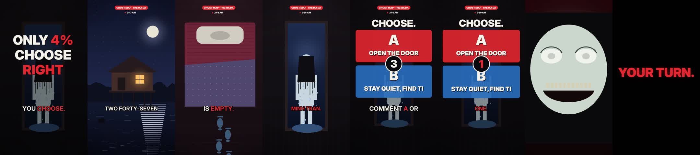

# Horror Short: bộ nghiên cứu và công cụ làm video kinh dị dọc

Nghiên cứu cách làm video kinh dị ngắn (TikTok / Reels / YouTube Shorts) theo phong cách **hoạt hình flat-vector + phụ đề tô đỏ từ khóa**, dựa trên một video mẫu ("Horror Spin · La Llorona"). Format được nâng cấp thêm:

- **Hook "giật tít"** ngay trong 0–3 giây đầu
- **Cao trào lựa chọn A/B**: người xem chọn, mỗi lựa chọn dẫn tới một kết (chết / sống / kết đảo ngược)
- **Nội dung tiếng Anh**, giọng đọc **trầm, chậm, đầy đe dọa**

▶ **Demo 10 giây:** [`examples/ma-da/preview/ma-da-demo-10s.mp4`](examples/ma-da/preview/ma-da-demo-10s.mp4)



## Tài liệu (đọc theo thứ tự)

| # | Tài liệu | Nội dung |
|---|---|---|
| 01 | [Phân tích video mẫu](docs/01-phan-tich-video-mau.md) | Dòng thời gian từng giây, lời thoại, phong cách hình ảnh, phụ đề, âm thanh (đo được −17,4 LUFS) |
| 02 | [Công thức kịch bản](docs/02-cong-thuc-kich-ban.md) | Khung 9 nhịp, quy tắc câu chữ, các kiểu twist, prompt AI |
| 03 | [Quy trình sản xuất](docs/03-quy-trinh-san-xuat.md) | 8 bước: format series → kịch bản → giọng → hình → dựng → phụ đề → âm thanh → xuất file |
| 04 | [Hook + kết lựa chọn A/B](docs/04-hook-va-ket-lua-chon-AB.md) | 7 công thức hook, khung 10 nhịp, thiết kế điểm chọn, 3 cách triển khai trên nền tảng |
| 05 | [Giọng đọc trầm](docs/05-giong-doc-tram.md) | Chọn giọng TTS tiếng Anh, cài đặt ElevenLabs, chuỗi xử lý cho giọng trầm và ghê |

## Ví dụ hoàn chỉnh: "The Ma Da" (Vietnam's drowned ghost)

- Kịch bản tiếng Anh ~100 giây, có hook, 3 manh mối, điểm chọn A/B và 2 cái kết: [`examples/ma-da/script.md`](examples/ma-da/script.md)
- Template trống để viết tập mới: [`templates/script-template.md`](templates/script-template.md)

## Công cụ (`tools/`)

| Script | Việc làm |
|---|---|
| `narration.py` | Lấy lời dẫn từ script.md ra file văn bản cho TTS (có chế độ audio tag cho ElevenLabs) |
| `voice_fx.sh` | Làm giọng trầm và ghê hơn: preset `deep`, `demon`, `whisper`, `radio` |
| `transcribe_words.py` | Lấy mốc thời gian từng từ trong giọng đọc (faster-whisper) |
| `make_captions.py` | Tạo phụ đề `.ass`: chữ HOA, 1–3 từ mỗi cụm, từ khóa `*...*` tô đỏ, hiệu ứng pop |
| `make_cards.py` | Tạo thẻ đồ họa: hook, luật, mẹo, màn chọn A/B có đếm ngược, dấu "YOU CHOSE", chữ kết |
| `render.py` | Dựng video từ ảnh tĩnh: Ken Burns, rung, flash, HUD đồng hồ, nhạc, SFX, phụ đề, chuẩn hóa −14 LUFS |

Chi tiết cách dùng: [`tools/README.md`](tools/README.md).

```bash
pip install pillow faster-whisper
```

```bash
bash examples/ma-da/build_demo10.sh
```

```bash
bash examples/ma-da/build_demo.sh
```

Lệnh thứ hai dựng demo 10 giây, lệnh thứ ba dựng bản nháp đủ ~105 giây (ảnh tạm). Cần `ffmpeg` (có `libass` và `rubberband`). Đặt giọng đọc tiếng Anh vào `examples/ma-da/voice.mp3` thì bản nháp đủ sẽ tự xử lý giọng cho trầm và căn phụ đề khớp từng từ.

## Lưu ý bản quyền và kiếm tiền

- Không sao chép brand, logo, intro của kênh gốc: hãy tự tạo format series riêng (gợi ý trong tài liệu 03, bước 0).
- Nên dùng truyền thuyết dân gian, SCP (giấy phép CC BY-SA, cần ghi nguồn) hoặc quái vật tự sáng tạo. Tránh nhân vật có chủ bản quyền (Siren Head, Samara…).
- Nhạc và SFX: chỉ dùng nguồn có giấy phép rõ ràng (CC0, Pixabay, YouTube Audio Library…).
