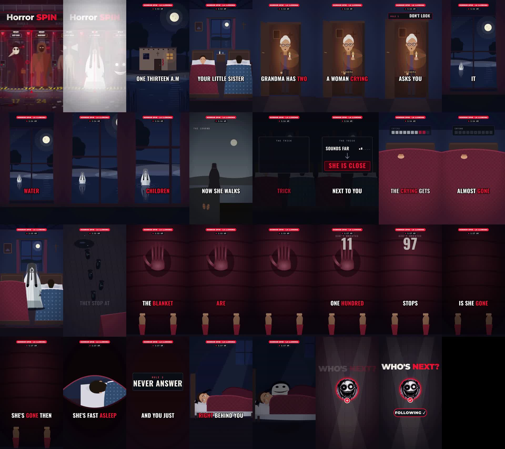

# 01 · Phân tích video mẫu ("Horror Spin · La Llorona")

> Video mẫu: dọc 720×1280, 30 fps, dài **93,3 giây**, âm thanh AAC 44,1 kHz.
> Toàn bộ lời thoại bên dưới được đọc lại từ phụ đề trên màn hình (phụ đề khớp từng chữ với giọng đọc).

---

## 1. Công thức tổng quát (tóm trong 1 dòng)

**Intro "quay số" chọn quái vật (5s) → truyện ngắn ngôi thứ 2 kiểu "luật lệ" (75s) → plot twist + jumpscare (5s) → CTA "Who's next?" bấm Follow (7s).**

Đây là một **series có format cố định**: mỗi tập chỉ thay quái vật + câu chuyện, còn intro, khung giao diện, phông chữ, màu sắc, outro giữ nguyên. Đây là lý do kênh kiểu này ra video được đều và người xem nhận ra ngay.

## 2. Dòng thời gian chi tiết

| Thời gian | Phần | Hình ảnh | Lời thoại / chữ trên màn hình |
|---|---|---|---|
| 0:00–0:05 | **Hook / Intro "SPIN"** | Hành lang các "phòng giam" (cell) chứa quái vật nổi tiếng, có số Block/Cell, đèn đỏ, băng cảnh báo vàng-đen. Camera lướt ngang như máy quay xổ số, chậm dần, flash trắng, dừng ở 1 cell. Thẻ: **"SUBJECT IDENTIFIED · LA LLORONA · THE WEEPING WOMAN"** | (nhạc + SFX quay số, "ting") |
| 0:06–0:13 | **Bối cảnh** | Ngôi nhà bên sông dưới trăng → phòng ngủ 2 giường | "New Mexico. One thirteen A.M. You're at your grandma's house by the **river**. Your little sister **Sofia** sleeps in the next **bed**." |
| 0:13–0:21 | **Đặt luật** | Bà cầm nến đứng ở cửa. Thẻ **"RULE 1 · DON'T LOOK"** | "Grandma has **two** rules. If you hear a woman **crying**, don't **look**. And whatever she asks you, never **answer**." |
| 0:21–0:32 | **Mối đe dọa xuất hiện** | Qua cửa sổ: bóng trắng đứng dưới sông, tiến dần | "Then you hear it. **Crying**. **Far** away. **Water**. *My children… Where are my children?*" |
| 0:32–0:37 | **Truyền thuyết (lore)** | Cảnh xám "THE LEGEND": bóng đen đứng bên sông | "She **drowned** her own children. Now she walks the **river** every night looking for them." |
| 0:37–0:41 | **"Mẹo" (twist cơ chế)** | Hộp "THE TRICK": *SOUNDS FAR → **SHE IS CLOSE*** | "And here's the **trick**. If she sounds **far** away, she is **right** next to you." |
| 0:41–0:49 | **Leo thang 1** | Góc nhìn từ trong chăn. Thanh đo **"CRYING"** giảm dần | "So you pull the **blanket** over your head. The **crying** gets **quieter**… **quieter**… almost **gone**. Which means she's in the **room**." |
| 0:49–0:54 | **Leo thang 2** | Dấu chân ướt trên sàn tiến tới giường | "**Water** drips on the floor. **Wet** footsteps. They stop at your **bed**." |
| 0:54–1:01 | **Đỉnh căng thẳng** | Bàn tay tái nhợt ấn lên chăn (rung nhẹ) | "Something **cold** presses down on the **blanket**. *Are… are… are my children…?*" |
| 1:01–1:08 | **Thử thách** | Bộ đếm **"DON'T BREATHE"** chạy 11 → 97 → 100 | "You don't **answer**. You don't **breathe**. You count to one **hundred**. The hand lifts. The dripping stops. **Silence**." |
| 1:08–1:17 | **Giả vờ an toàn** | Màn hình tối, vignette | "Is she **gone**? You **whisper**. Back: *Yeah. She's **gone** then.* You **look** at Sofia's **bed**. She's fast **asleep**." |
| 1:17–1:21 | **PLOT TWIST** | Thẻ "RULE 2 · NEVER ANSWER" bị đóng dấu **BROKEN** | "She never said a **word**. And you just **answered**." |
| 1:21–1:25 | **Jumpscare** | Nhân vật nằm, sau lưng hiện mặt trắng cười | "**Blanket**. **Right** behind you. Something **wet** starts to **smile**." |
| 1:25–1:27 | **Chữ kết** | Màn đen, chữ đỏ **"MINE."** | (stinger âm thanh) |
| 1:27–1:33 | **CTA** | Logo mascot, "WHO'S **NEXT**?", tay bấm **FOLLOW → FOLLOWING ✓** | (gợi ý xem tập sau / follow) |

## 3. Kịch bản: vì sao giữ chân được người xem

1. **Ngôi thứ 2 ("You…")** – người xem trở thành nhân vật, không phải nghe kể chuyện người khác.
2. **Thể loại "Rules horror"** – đặt 2 luật ngay đầu → khán giả *biết trước* điều cấm, và chờ xem luật bị phá thế nào. Đây là "vòng lặp tò mò" (open loop) kéo đến cuối video.
3. **Cài cắm → trả lại (setup/payoff)**:
   - Luật 2 "never answer" → cuối cùng chính nhân vật trả lời.
   - Chi tiết em gái Sofia ở câu thứ 3 → được dùng để lật kèo ("she never said a word").
   - "The trick: far = close" → biến tiếng khóc nhỏ dần thành *đáng sợ hơn* chứ không phải an toàn.
4. **Câu cực ngắn, 2–6 chữ**, nhịp đều, gần như không có câu phức. Phù hợp phụ đề từng cụm từ.
5. **Lặp lại để tạo nhịp** ("quieter… quieter", "are… are… are", "starts to smile / starts to smile").
6. **Giả an toàn trước cú lật** – "Silence. Is she gone?" hạ nhịp tim xuống ngay trước twist.
7. **Kết bằng jumpscare + 1 chữ ("MINE.")** rồi CTA ngay → không có khoảng chết để người xem lướt đi trước khi thấy nút Follow.

**Độ dài lời thoại:** ~190 từ tiếng Anh trong ~80 giây nói ≈ **140–150 từ/phút** (chậm, rõ, có khoảng ngừng).

## 4. Phong cách hình ảnh

- **Flat vector 2D** (không có nét viền, đổ bóng phẳng, gradient nhẹ), nhân vật đơn giản kiểu "minimal cartoon". Dễ sản xuất hàng loạt và dễ giữ đồng bộ giữa các tập.
- **Bảng màu**: xanh navy đêm (#1b2140 ~ #2a3159), đỏ rượu vang/đỏ tía (#5a1a2e ~ #8c2a45) cho cảnh căng thẳng, trắng ngà cho con ma, đỏ tươi (#e3262f) làm màu nhấn.
- **Chuyển động** (của video mẫu, KHÔNG áp dụng cho Battle Spin: xem docs/07) chủ yếu là: zoom chậm (Ken Burns), trượt ngang, rung nhẹ (camera shake), nhấp nháy đèn, vignette co lại, nhân vật xuất hiện/tiến gần dần. Gần như không có hoạt hình nhân vật phức tạp → **chi phí thấp**.
- **Lớp giao diện (HUD) cố định trên cùng**: nhãn đỏ "HORROR SPIN · LA LLORONA" + đồng hồ **1:13 AM → 1:17 AM** chạy theo truyện. Đồng hồ đóng vai trò *thanh tiến trình* ngầm, cho người xem cảm giác "sắp đến lúc".
- **Đồ họa thông tin (infographic) chen giữa**: thẻ RULE, hộp THE TRICK, thanh đo CRYING, bộ đếm DON'T BREATHE, dấu BROKEN. Đây là điểm khác biệt lớn so với các video kinh dị đọc truyện thông thường – chúng biến câu chuyện thành "game" và làm mắt luôn có thứ mới để nhìn mỗi 2–4 giây.

## 5. Phụ đề (caption)

- Phông chữ dạng **condensed in đậm, viết HOA** (giống *Oswald Bold* / *Bebas Neue* / *Anton*).
- Vị trí: **khoảng 68–72% chiều cao** khung hình (trên vùng nút/caption của TikTok/Shorts), căn giữa.
- **1–4 chữ mỗi lần**, đổi khoảng mỗi 0,5–1 giây, khớp đúng giọng đọc.
- Chữ trắng + **1 từ khóa tô đỏ** mỗi cụm (river, bed, two, crying, look, answer…). Có viền/đổ bóng đen mềm.
- Hiệu ứng xuất hiện: fade/pop nhanh (~100 ms).

## 6. Âm thanh

- Độ to tổng: **−17,4 LUFS**, dải động (LRA) chỉ **3 LU** → được nén mạnh, mức to đều suốt video (chuẩn cho điện thoại).
- Không có đoạn im lặng thật sự nào (> 0,6 s dưới −35 dB) → luôn có **nền nhạc ambient/drone** chạy liên tục; "Silence" trong truyện được thể hiện bằng *giảm* nhạc chứ không tắt hẳn.
- Các lớp cần có: giọng đọc trầm, chậm · drone tối · SFX theo chữ (tiếng nước, tiếng khóc xa, bước chân ướt, tiếng tim đập, whoosh khi đổi cảnh, "ting/click" ở intro spin) · stinger to ở jumpscare.
- *(Lưu ý: tôi không nghe trực tiếp được giọng đọc trong môi trường này; nhận xét giọng đọc dựa trên nhịp phụ đề. Hãy tự nghe lại để chọn giọng TTS tương tự.)*

## 7. Những thứ KHÔNG nên sao chép

- Tên/brand "Horror Spin", logo mascot và thiết kế intro của kênh gốc → hãy tự tạo **format series riêng** (xem [03-quy-trinh-san-xuat.md](03-quy-trinh-san-xuat.md#buoc-0)).
- Một số quái vật trong intro là **nhân vật có bản quyền** (ví dụ Siren Head – Trevor Henderson; Samara – The Ring). Truyền thuyết dân gian (La Llorona, Kuchisake-onna, ma da, ma lai…) và SCP (giấy phép CC BY-SA, cần ghi nguồn) an toàn hơn nhiều.
